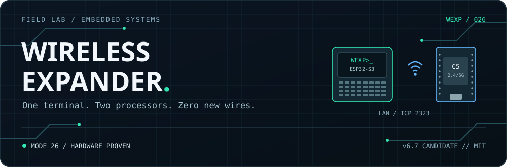
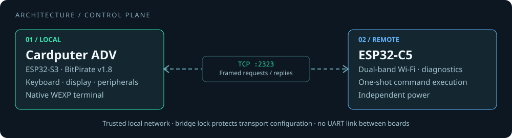

<div align="center">



# BitPirate C5 Wireless Expander

**A wireless coprocessor for the Cardputer ADV.**


[Architecture](#architecture) · [Commands](#commands) · [Build notes](docs/BUILD.md) · [Validation](docs/VALIDATION.md) · [Compatibility](docs/COMPATIBILITY.md) · [Changelog](CHANGELOG.md)

</div>

> **Protect the control plane first. Expand the capabilities second.**

An independent experimental extension for [ESP32 Bit Pirate](https://github.com/geo-tp/ESP32-Bit-Pirate), designed to let an M5Stack Cardputer ADV access an ESP32-C5 over a trusted local network while retaining its existing peripheral hardware.

**Development milestone: v6.7 — Bridge-Safe C5 candidate, with the hardware-validated v6.6 Cardputer integration (November 28, 2026).** The new `ls` command and prerequisite checks have been demonstrated on hardware; the full v6.7 regression suite is pending. This is not an official upstream release or production-ready firmware.

```text
24. LORA
25. EXPANDER
26. WIRELESS EXPANDER

Mode Number > 26
Mode changed to WIRELESS EXPANDER

WEXP> host 192.168.1.50
C5 host set: 192.168.1.50
WEXP> ping
[C5]
PONG FROM ESP32-C5
[C5 response complete]
```

The address above is illustrative. Use the private IPv4 address of your own C5.

## Architecture



The original wired EXPANDER remains mode 25. Mode 26 adds a wireless route rather than replacing upstream drivers. The S3 owns the terminal; the C5 executes supported one-shot diagnostic requests. Global `c5` shortcuts remain available outside WEXP.

## Design principles

| **Keep local hardware** | **Protect the bridge** | **Extend independently** |
| :--- | :--- | :--- |
| No additional inter-board wiring; original wired mode 25 retained. | Keep link-breaking remote operations out of the framed route. Bridge lock is not authentication. | Upgrade C5 diagnostic commands without reflashing the Cardputer when the protocol is unchanged. |

## Verified on hardware — v6.6 / C5 v6.5

| Function | Result |
| --- | --- |
| Mode 26 selection and WEXP prompt | Pass |
| Integrated help, mode switching, exit to HIZ | Pass |
| C5 host configuration, PING, VERSION | Pass |
| Uppercase and lowercase VERSION | Pass |
| 2.4 GHz and 5 GHz discovery | Pass |
| Weather API requests | 3 successful queries |
| C5 internal self-test | 15/15 |
| Unsupported command rejection | Pass |

See [validation notes](docs/VALIDATION.md) for scope and remaining gaps. These results are a development milestone, not exhaustive regression or endurance testing.

## v6.7: bridge-safe expansion

Mode 25 compatibility is being expanded without replacing the wireless transport or relaxing the bridge lock. The existing Cardputer image does not require another flash for this C5-side upgrade.

- New `ls` / `commands` inventory and Wi-Fi help.
- Flexible band-selection syntax, CSV scan aliases and channel filtering.
- Wi-Fi-prefixed network, DNS, TCP and HTTP diagnostic commands.
- Local IPv4 and MAC classification (not geolocation or vendor lookup).
- No additional Zigbee dependency, partition change or Wi-Fi configuration operation.

The new inventory was returned successfully through WEXP on physical hardware. The candidate package passed 75 host-side assertions; the remaining individual command tests are documented in [validation notes](docs/VALIDATION.md). See [mode 25 compatibility](docs/COMPATIBILITY.md) for the scope and safety boundaries.

## Hardware and setup

- M5Stack Cardputer ADV (ESP32-S3), BitPirate v1.8.
- ESP32-C5 development board with independent power.
- A trusted LAN permitting communication between the two boards; no soldering required for the wireless link.

See [build and installation notes](docs/BUILD.md), [protocol](docs/PROTOCOL.md), and [security limitations](SECURITY.md). The C5 sketch and exact installers are being staged for publication; do not assume the repository is flash-ready until the complete source package has been committed.

## Commands

From mode 14 (WIFI), connect to the LAN. Enter `mode wexp` or select 26 from the mode menu.

| Command | Purpose |
| --- | --- |
| `help` | Local WEXP help |
| `host <IPv4>` | Configure C5 address until reboot |
| `host` | Display configured address |
| `ping` | Test remote bridge |
| `version` | Retrieve C5 firmware version |
| `info` | Retrieve C5 system information |
| `commands` / `ls` (v6.7) | List remote command inventory |
| `wifi scan24` / `wifi scan5` | Band-specific discovery |
| `dns example.com` | DNS resolution |
| `4cast <ZIP>` | Weather lookup |
| `selftest` | C5 internal diagnostics |
| `exit` | Return to HIZ |

Use only networks and equipment you own or are authorized to test. On v6.7, `wifi scan 5` and `wifi scan5` are supported aliases; hardware testing of the new spelling is pending. The older C5 v6.5 requires `wifi scan5`.

## Roadmap

- [x] v6.5: framed wireless transport
- [x] v6.6: native mode 26 and physical-device validation
- [x] v6.7: expanded command inventory demonstrated on hardware; 75 host-side assertions passed
- [ ] Complete v6.7 hardware regression and source publication
- [ ] Persistent host configuration and usability improvements
- [ ] Client lifecycle recovery, bounded operations and authentication
- [ ] Isolated Zigbee discovery/coexistence experiment (not enabled by default)
- [ ] Documented public beta
- [ ] Discuss upstream integration with geo-tp

## Attribution and license

Built independently on [geo-tp/ESP32-Bit-Pirate](https://github.com/geo-tp/ESP32-Bit-Pirate/tree/v1.8). Inspired by the [ESP32 Bus Expander](https://github.com/geo-tp/ESP32-Bus-Expander). Thanks to geo-tp, the upstream contributors, M5Stack and Espressif. This project is not endorsed by or affiliated with those projects or companies.

Project license: [MIT](LICENSE). Upstream license notices must be retained when distributing derived code.
