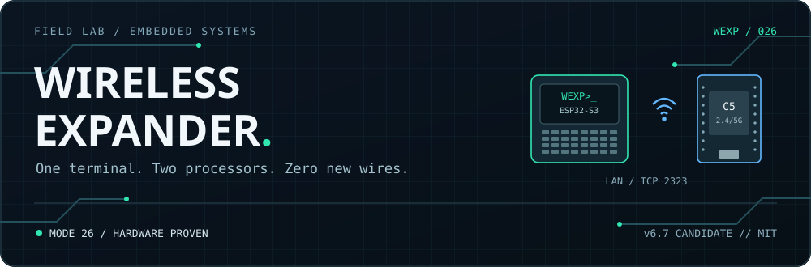
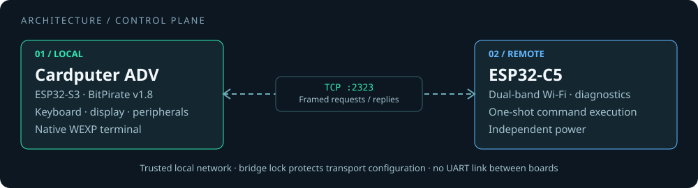

<div align="center">



# 24gb86mgyr-cmd

**Embedded systems · Firmware development · Network diagnostics**

Building practical tools at the intersection of hardware, software and systems engineering.

[Flagship project](https://github.com/24gb86mgyr-cmd/BitPirateC5WirelessExpander) · [Development log](https://github.com/24gb86mgyr-cmd/BitPirateC5WirelessExpander/blob/main/CHANGELOG.md) · [Architecture](https://github.com/24gb86mgyr-cmd/BitPirateC5WirelessExpander#architecture)

</div>

## Currently building

### [BitPirate C5 Wireless Expander](https://github.com/24gb86mgyr-cmd/BitPirateC5WirelessExpander)

A wireless expansion for ESP32 Bit Pirate: a Cardputer ADV terminal controlling an independently powered ESP32-C5 over a trusted local network. No additional wiring between the boards.



| Milestone | State |
| :--- | :--- |
| Native **26. WIRELESS EXPANDER** | Hardware validated |
| Dual-band Wi-Fi diagnostics | Validated on v6.5 |
| v6.7 bridge-safe compatibility | Initial hardware validation |
| Public source release | In preparation |
| Zigbee coexistence | Planned experiment |

```text
WEXP> ping
[C5]
PONG FROM ESP32-C5

[C5 response complete]
```

## Engineering approach

- Preserve working functionality; make changes reversible.
- Prefer measured results over speculative feature lists.
- Keep transport reliability separate from application features.
- Credit upstream contributors and document known limitations.

**Working with:** ESP32-S3 / C5 · C++ · Arduino · PlatformIO · Python · TCP/IP · Git

## Upstream inspiration

[geo-tp / ESP32 Bit Pirate](https://github.com/geo-tp/ESP32-Bit-Pirate) · [ESP32 Bus Expander](https://github.com/geo-tp/ESP32-Bus-Expander)

Independent development; no upstream endorsement implied.

<div align="center">

**Build. Test. Iterate.**

</div>
